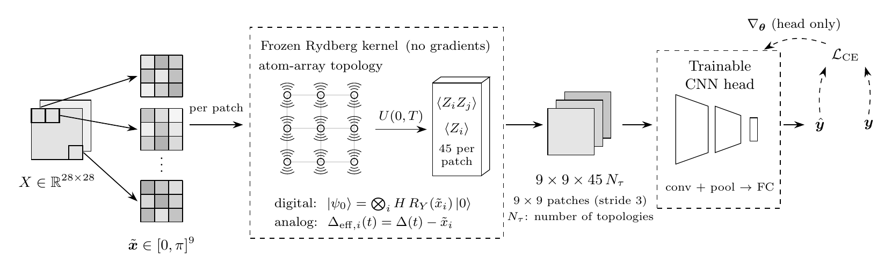

# DAQCNN with matched classical nonlinearity

[](https://github.com/NunoMBatista/DAQCNN-Classical-Nonlinearity/actions/workflows/tests.yml)
[](requirements.txt)
[](https://pennylane.ai)
[](LICENSE)

Code for the paper *Reproducing the Apparent Quantum-Kernel Advantage of
Rydberg-Atom DAQCNN Using Classical Nonlinearity* (accepted at IEEE QAI 2026).

A Digital-Analog Quantum Convolutional Neural Network (DAQCNN, Simen et al.,
2024) applies fixed Rydberg-atom quantum kernels to 3x3 image patches and
trains only a classical head on the resulting features. This repository runs
it on BreastMNIST, PneumoniaMNIST and TissueMNIST and compares it with random
projections, a degree-2 polynomial map and random Fourier features of the
same dimension, across classifier heads of increasing capacity.



## Main result

Most of the apparent quantum-kernel advantage is reproduced by classical
nonlinear features of the same dimension.

- On BreastMNIST and PneumoniaMNIST, equal-dimension random Fourier features
  largely reproduce the quantum lead over a linear random projection, across
  five classifier heads from linear to CNN.
- Only on TissueMNIST does the quantum kernel lead matched classical
  nonlinearity beyond a 0.01 AUC margin: at the linear head (AUC 0.828 against
  0.814). A trained CNN head reverses it (end to end, a degree-2 polynomial map
  scores 0.896 against 0.880).
- The protocol carries over to any quantum feature map: compare it with tuned
  classical nonlinear maps of equal dimension, across classifier capacities,
  and select models on validation data.

Experiment outputs and the precomputed feature caches (about 80 GB) are not
included; the commands below regenerate them.

## Method

### Rydberg Hamiltonian

Each kernel places 9 atoms at the coordinates of its topology and evolves them
under

$$H(t) = \frac{\Omega(t)}{2} \sum_i X_i \;-\; \Delta(t) \sum_i \hat{n}_i \;+\; \sum_{i < j} \frac{C_6}{r_{ij}^6} \, \hat{n}_i \hat{n}_j$$

with linear ramps $\Omega(t) = \Delta(t) = t$, $\hat{n}_i = (1 - Z_i)/2$ the Rydberg
occupation, $r_{ij}$ the distance between atoms and $C_6$ the `scaling_factor`
(1.0). The evolution runs from $t = 0$ to $T = 2.5$ as first-order Trotter steps
of $\delta t = 0.05$, with $H$ frozen at the start of each step.

### Encoding

Each image is min-max normalised to $[0, \pi]$ (per image), and each patch gives
nine values $x_i$.

- **Digital**: $R_Y(x_i)$ followed by a Hadamard on every qubit, then evolution under $H(t)$.
- **Analog**: start in $|0\cdots0\rangle$ and add $\sum_i x_i \hat{n}_i$ to $H(t)$, so each atom sees the detuning $\Delta(t) - x_i$ throughout the evolution.

### Features

After the evolution the features are

$$\langle Z_i \rangle \quad \text{for all qubits } i, \qquad \langle Z_i Z_j \rangle \quad \text{for all pairs } i < j,$$

$9 + \binom{9}{2} = 45$ per patch and topology (9 without the correlators, "Z-only").
The paper finds that the gain from the $\langle Z_i Z_j\rangle$ terms is mostly
carried by the product $\langle Z_i\rangle\langle Z_j\rangle$ of single-qubit marginals.
Four topologies run side by side give $4 \times 45 = 180$ channels. On a 28x28
image with stride 3 each channel is a 9x9 map.

### Classical head

The end-to-end models train

$$\text{Conv}_{2 \times 2}\text{-BN-Act} \;\to\; \text{MaxPool} \;\to\; \text{Conv}_{2 \times 2}\text{-Act} \;\to\; \text{Dropout} \;\to\; \text{Flatten} \;\to\; \text{Dropout} \;\to\; \text{Linear}(d, C)$$

with 64 channels; the quantum kernels are never trained. The head-capacity
sweep uses a linear head, MLPs with one and two hidden layers, and this head
with 16 and 64 channels.

### Topologies

Coordinates are on a 3x3 grid of unit spacing; an atom moved 100 units away is
effectively decoupled ($C_6/r^6 \approx 10^{-12}$).

| Name | Geometry |
|------|----------|
| `kings` | full 3x3 grid, unit spacing |
| `horizontal` | the three rows, decoupled from each other |
| `vertical` | the three columns, decoupled from each other |
| `cross` | centre and its four edge neighbours; corners decoupled |
| `ring` | the eight outer atoms; centre decoupled |
| `chain` | all nine atoms on one line, unit spacing |
| `star` | centre atom with the other eight on the unit circle around it |
| `grid` | the `kings` grid scaled by 1.5 (weaker couplings, diagonals 1/8 of the nearest ones) |

## Installation

Python 3.12, from the repository root:

```bash
pip install -r requirements.txt
```

The MedMNIST datasets download into `data/` on first use. Run every command
from the repository root.

## Quick start

Quantum features and their classical controls for two random images, in a few
seconds on a laptop (from the repository root, e.g. in `python`):

```python
import torch
from src.layers.quantum_convolution import QuantumConv2d
from src.utils.classical_nonlinear_features import poly2_features, rff_features

images = torch.rand(2, 1, 28, 28)  # two 28x28 grayscale images in [0, 1]

# One nine-atom Rydberg kernel per 3x3 patch, reading out <Z_i> and <Z_i Z_j>
qconv = QuantumConv2d(
    kernel_size=3, stride=3, kernel_topology_names=["kings"],
    evolution_time=2.5, include_correlators=True, encoding_mode="digital",
    quantum_device="lightning.qubit",
)
with torch.no_grad():
    quantum = qconv(images)
print(quantum.shape)                  # torch.Size([2, 45, 9, 9])

# Classical nonlinear controls of the same shape
print(poly2_features(images).shape)   # torch.Size([2, 45, 9, 9])
print(rff_features(images, 45).shape) # torch.Size([2, 45, 9, 9])
```

## Workflow

**1. Cache the quantum features.** Simulating the circuits for every batch is
too slow, so each dataset is run through the kernels once:

```bash
python experiments/create_quantum_dataset.py --config configs/breast_mnist/cache_generation/digital_zz.yml
```

This writes `data/quantum_datasets/<name>.npz` and a `.json` sidecar that the
other scripts use to find the cache. A cache with several topologies serves any
subset of them. Z-only caches are sliced from Z+ZZ caches for free
(`experiments/derive_z_from_zz.py --zz <cache>_zz.npz`). For large datasets,
`--split/--start/--end/--chunk-dir` computes one index range per job and
`experiments/merge_quantum_chunks.py` joins the chunks. The poly-2 and RFF
features are cached in the same format with
`experiments/create_classical_cache.py --dataset <name> --source poly2_45|rff_45|rff_180`.
Analog caches are the expensive step (the circuits run one patch at a time);
the PneumoniaMNIST and TissueMNIST ones were built on an HPC cluster in chunk
mode.

**2. Train.** The end-to-end search trains on the cached features (it stops if
no cache matches):

```bash
python experiments/hyperparameter_search.py \
    --config configs/breast_mnist/original/1_kernel_3x3_digital_zz.yml \
    --search-config configs/breast_mnist/hp_search/digital_zz_single_kernel_search.yml \
    --n-trials 200 --validate-top-k 1 --validation-seeds 0 1 2 3 4 5 6 7 8 9
```

`--resume` continues a study. The search config has a `settings` block (the
objective metric, `val_acc` in every config here) and a `search_space` block:

```yaml
settings:
  metric: val_acc
  direction: maximize
  study_name: my_search

search_space:
  model.kernel_topology_names:
    type: categorical
    choices: [["vertical"], ["horizontal"], ["star"]]
  optim.lr:
    type: loguniform
    low: 1.0e-8
    high: 5.0e-3
  model.include_correlators:
    type: fixed          # not searched, just overrides the base config
    value: true
```

Distribution types: `uniform`, `loguniform`, `int`, `categorical`, `fixed`. Each
trial trains one seed; the validated trials are re-trained on every
`--validation-seeds` seed and summarised in `validation/validation_summary.json`.

## Reproducing the paper

| Result | Command (configs) |
|---|---|
| Fig. 2, topologies | `python experiments/gen_atom_topologies_tikz.py` |
| Table I and Figs. 3-4, head-capacity sweep | `python experiments/head_capacity_sweep.py --dataset <name> --output-dir outputs/paper_results/capacity_sweep_std/<name>` (sources: `configs/<name>/*_best.yml`; TissueMNIST adds `--num-classes 8 --batch-size 256 --epochs 80 --n-trials 20`); after parallel runs, `rebuild_capacity_summary.py` |
| Fig. 3 | `python experiments/plot_capacity_grid.py` |
| Fig. 4 | `python experiments/plot_capacity_delta.py` |
| Validation-selected capacity margins | `python experiments/val_selected_margins.py` |
| Table II, search spaces | `configs/breast_mnist/hp_search/`, `configs/tissue_mnist/hp_search/endtoend_search.yml` |
| Table III, BreastMNIST and PneumoniaMNIST | `hyperparameter_search.py` with a base config from `configs/<name>/original/` (quantum), `classical_baseline_base_1kern.yml` / `classical_baseline_base.yml` / `classical_raw_image_base.yml` (classical) or `classical_nonlinear/` (poly-2, RFF), and the matching search config in `configs/breast_mnist/hp_search/` (used for both datasets); `--n-trials 200 --validate-top-k 1 --validation-seeds 0 ... 9` |
| Table III, Random rows with frozen filters | `python experiments/e2e_random_fixed_revalidate.py --dataset BreastMNIST --row "Random x45"` (and x180, PneumoniaMNIST) |
| Table III, TissueMNIST | `hyperparameter_search.py --config configs/tissue_mnist/endtoend/<model>.yml --search-config configs/tissue_mnist/hp_search/endtoend_search.yml --n-trials 25 --validate-top-k 1 --validation-seeds 0 1 2 3 4` |
| Paired intervals and equivalence tests | `python experiments/paired_seed_intervals.py` |
| Validation-selected end-to-end margins | `e2e_val_reinference.py`, then `val_selected_e2e.py --random-fixed` |
| Bootstrap over test examples, end-to-end | `python experiments/e2e_example_level_intervals.py` |
| Bootstrap over test examples, TissueMNIST linear head | `projection_redraw.py --dataset tissue_mnist --num-classes 8 --frozen-seed 42 --save-predictions ...`, then `tissue_linear_head_bootstrap.py` |
| Projection redraw | `projection_redraw.py` (with and without `--frozen-seed 42`), then `projection_redraw_compare.py` |
| Repeated BreastMNIST search, val accuracy vs val AUC selection | `capacity_repeat_val_auc.py`, then `capacity_repeat_readout.py` |
| Linear probes (BreastMNIST, PneumoniaMNIST) | `linear_probing_topology_sweep.py --dataset <name>`; seed-averaged classical baselines: `probe_classical_nonlinear.py` |
| Linear probes (TissueMNIST) and Tissue topologies | `probe_tissue.py all-encodings --cache digital\|analog`, `probe_tissue.py topologies`, `probe_tissue.py analog-topology` |
| ZZ decomposition (product vs connected part) | `probe_zz_decomposition.py --cache <zz cache>` (TissueMNIST: `--estimator logreg --max-rows ...`) |
| Evolution-time sweep | caches from `configs/tsweep/` (chunk mode, `tsweep_merge.py`), then `tsweep_probe.py` |
| Trotter error | `trotter_convergence_check.py --enc digital\|analog`, `exact_feature_cache.py`, `exact_probe.py` |
| TissueMNIST fairness re-check | `verify_tissue_advantage.py [SEED]` (seeds 0-5) |

All scripts are in `experiments/`. The TissueMNIST caches are 23 to 47 GB; the
scripts that load them need a large-memory machine (the ZZ-cache jobs used about
200 GB of RAM).

## Tests

```bash
python -m pytest tests
```

## Layout

```
src/physics/     Hamiltonian, time evolution, topology coordinates
src/layers/      quantum kernel layer (DAQKLayer) and sliding-window QuantumConv2d
src/models/      DAQCNN, classical baselines, training loop
src/utils/       data loading, feature caches, heads, metrics, poly-2 / RFF maps
configs/         end-to-end, search, capacity-sweep, cache and T-sweep configs
experiments/     every script behind the paper
tests/           fast analytic checks
```

## Citation

```bibtex
@inproceedings{batista2026reproducing,
  title     = {Reproducing the Apparent Quantum-Kernel Advantage of Rydberg-Atom DAQCNN Using Classical Nonlinearity},
  author    = {Batista, Nuno and Morgado, Ana and Ferraz, Oscar and Pratapsi, Sagar Silva and Lobo, Jorge and Falc{\~a}o, Gabriel},
  booktitle = {2026 IEEE 2nd International Conference on Quantum Artificial Intelligence (QAI)},
  year      = {2026},
  note      = {Accepted}
}
```

The DAQCNN framework is from Simen et al.:

```bibtex
@article{simenDigitalanalogQuantumConvolutional2024a,
  title = {Digital-Analog Quantum Convolutional Neural Networks for Image Classification},
  author = {Simen, Anton and Flores-Garrigos, Carlos and Hegade, Narendra N. and
            Montalban, Iraitz and Vives-Gilabert, Yolanda and Michon, Eric and
            Zhang, Qi and Solano, Enrique and Mart{\'i}n-Guerrero, Jos{\'e} D.},
  journal = {Physical Review Research},
  volume = {6},
  number = {4},
  pages = {L042060},
  year = {2024},
  doi = {10.1103/PhysRevResearch.6.L042060}
}
```

## License

MIT (see `LICENSE`).
